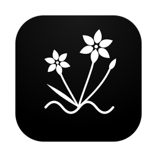
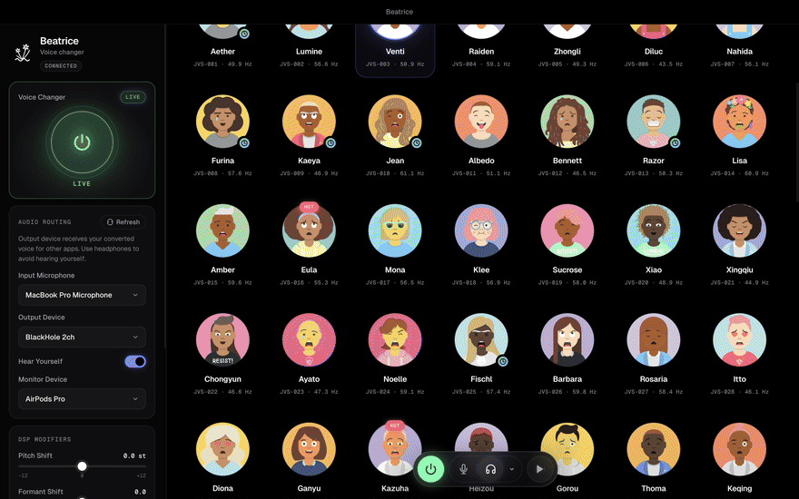
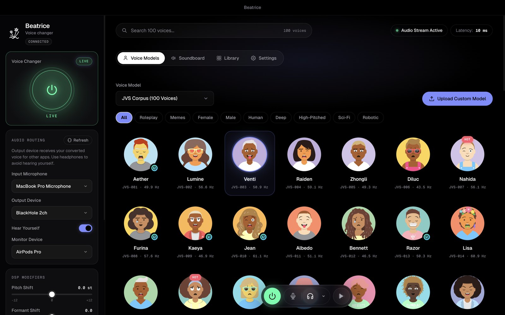
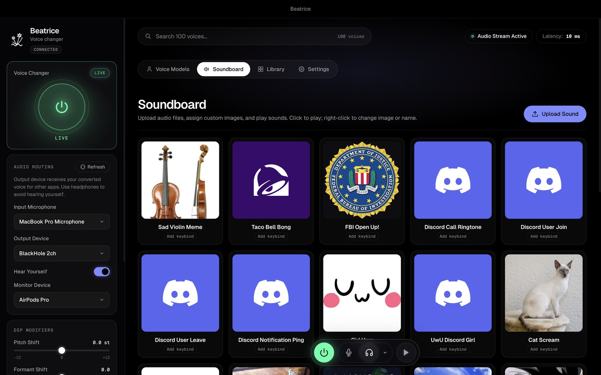
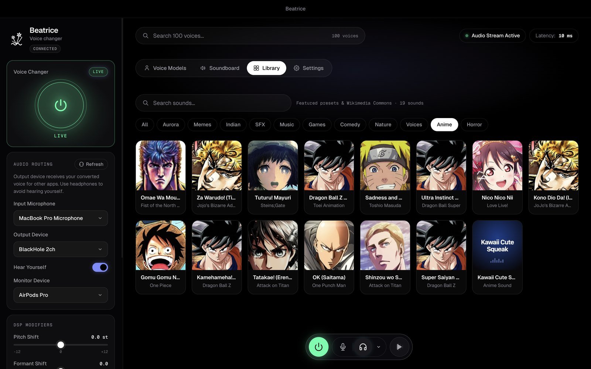
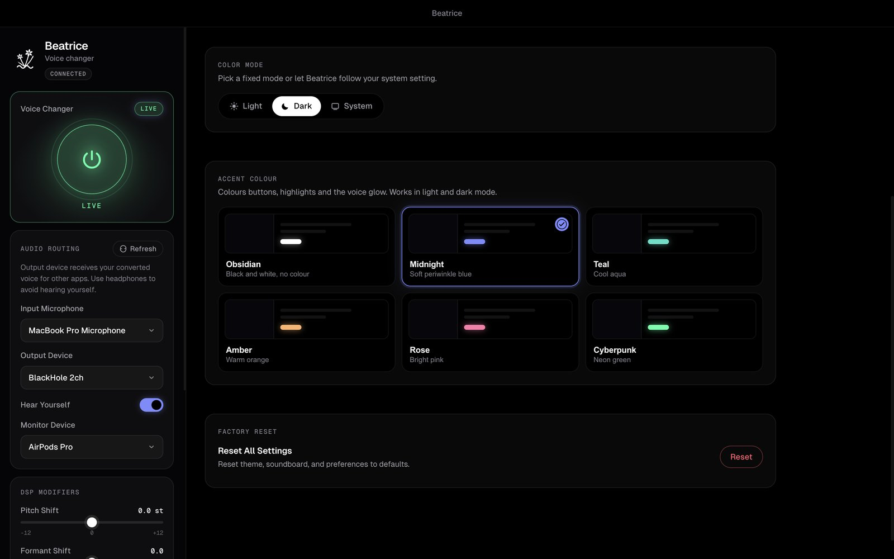
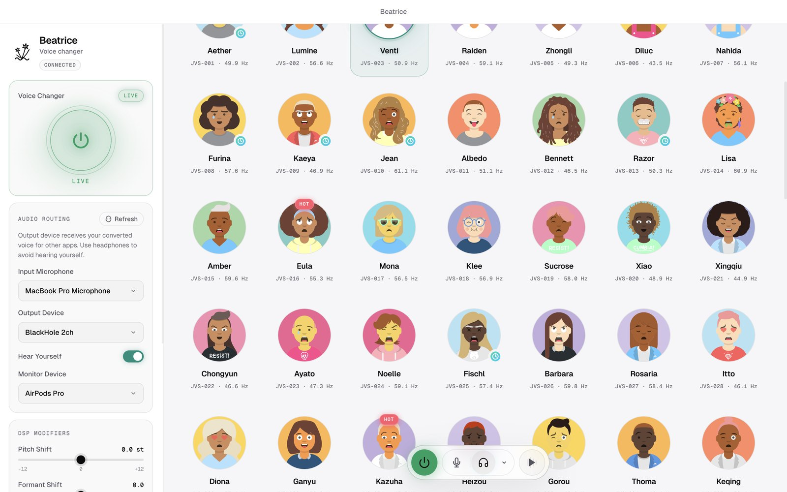
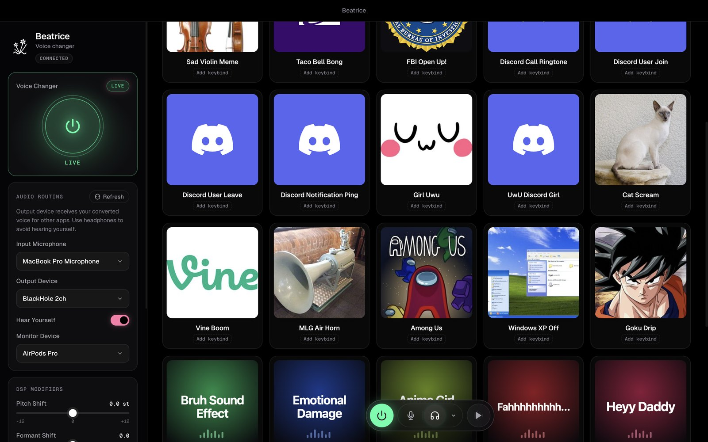
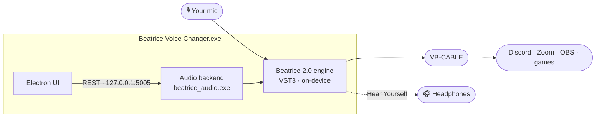

<div align="center">



# Beatrice for Windows

**A free, real-time AI voice changer that runs entirely on your PC.**<br/>
112 voices, a meme soundboard and a virtual microphone for Discord, Zoom, OBS and games. Install it, open it, talk.

[](https://github.com/satiricalguru/Beatrice-voicechanger-windows/releases/latest)
[](https://project-beatrice.vercel.app)
[](https://github.com/Project-Beatrice-V2)


[Download](https://github.com/satiricalguru/Beatrice-voicechanger-windows/releases/latest) · [Website](https://project-beatrice.vercel.app) · [Mac version](https://github.com/satiricalguru/Beatrice-voicechanger-mac) · [Report a bug](https://github.com/satiricalguru/Beatrice-voicechanger-windows/issues/new)

<br/>



<sub>▶︎ <a href="docs/media/app-demo.mp4">Watch the demo in HD</a> · Screens show the Mac build; the Windows app has the same interface.</sub>

</div>

---

## ✨ Why Beatrice

- 🎙️ **Real-time, on-device.** The Beatrice neural engine converts your voice live with about 10 ms of latency. Your audio never leaves your PC.
- 📦 **Nothing to set up.** The audio engine and every voice are inside the app. No Python, no pip, no command line.
- 🔌 **Virtual mic in one click.** On first launch Beatrice offers to install [VB-CABLE](https://vb-audio.com/Cable/) for you and then selects it, so Discord, Zoom and OBS can hear your new voice.
- 🎭 **112 voices + your own.** Three built-in model sets, plus any Beatrice-compatible model you import.
- 🔊 **A soundboard that's ready to go.** 23 sounds from the Aurora pack are on it from the start, with 100+ more in the library, each with artwork of what it is.
- 🎨 **Looks the part.** A black-and-white "Aurora Void" design, six accent colours, light and dark mode, in English, 日本語 and 中文.

## 📸 Tour

<table>
  <tr>
    <td width="50%"></td>
    <td width="50%"></td>
  </tr>
  <tr>
    <td><b>Voice Models</b><br/>Pick from 112 voices and filter by style. The power button goes LIVE in one click.</td>
    <td><b>Soundboard</b><br/>Play memes and effects into your call. Give any sound a global keyboard shortcut.</td>
  </tr>
  <tr>
    <td width="50%"></td>
    <td width="50%"></td>
  </tr>
  <tr>
    <td><b>Library</b><br/>100+ curated sounds in 11 categories, plus Wikimedia Commons search. One click adds a sound to your board.</td>
    <td><b>Settings</b><br/>Light, dark or system mode, six accent colours and three languages.</td>
  </tr>
  <tr>
    <td width="50%"></td>
    <td width="50%"></td>
  </tr>
  <tr>
    <td><b>Light mode</b> with the Teal accent.</td>
    <td><b>Accents</b> recolour buttons, highlights and the voice glow.</td>
  </tr>
</table>

## 🚀 Get started

1. **Download** from the [latest release](https://github.com/satiricalguru/Beatrice-voicechanger-windows/releases/latest):
   - `Beatrice.Voice.Changer.Setup.2.2.0.exe`: the installer, with Start menu and desktop shortcuts (recommended)
   - `Beatrice.Voice.Changer-2.2.0-win.zip`: portable, unzip and run `Beatrice Voice Changer.exe`
2. **Run it.** If Windows SmartScreen says it protected your PC, click **More info → Run anyway**. You do this once.
3. **Click "Install VB-CABLE"** when Beatrice offers the virtual microphone. Beatrice downloads it from vb-audio.com and opens its installer: click **Install Driver** and allow the Windows prompt. Beatrice then selects **CABLE Input** as its output for you.
4. **Press the power button** so it says **LIVE**, and pick a voice.
5. In **Discord, Zoom or OBS**, choose **CABLE Output (VB-Audio Virtual Cable)** as the microphone.

> [!TIP]
> Turn on **Hear Yourself** and pick your headphones as the monitor to hear your converted voice while you talk.

> [!NOTE]
> **Requires Windows 10 or 11, 64-bit.** If the cable doesn't show up straight away, restart your PC once, as VB-Audio recommends.

<details>
<summary><b>Why does SmartScreen warn me?</b></summary>
<br/>

Beatrice is free and isn't signed with a paid code-signing certificate, so Windows doesn't recognise it yet. Click **More info → Run anyway**.
</details>

<details>
<summary><b>I clicked "Not now" on VB-CABLE</b></summary>
<br/>

Beatrice offers it again the next time you open it. You can also install it yourself from [vb-audio.com/Cable](https://vb-audio.com/Cable/) and click **Refresh** under Audio Routing.
</details>

## 🎭 Voices

| Model | Voices | What's inside |
|:--|:--:|:--|
| **JVS Corpus (100 Voices)** | 100 | A wide range of speakers from the Japanese Versatile Speech corpus |
| **Official Model (3 Voices)** | 4 | Tsukuyomi-chan, Tokinashi Shigure, OLUNE and Fukuyomi-chan |
| **Classic Old TTS (8 Voices)** | 8 | Retro synthesised voices |
| **Custom models** | ∞ | Import any Beatrice-compatible model as a ZIP |

**Import your own:** open the model menu, choose **Upload Custom Model** and pick a ZIP that contains a `beatrice_paraphernalia_*` folder. Train one with the [Beatrice trainer for Windows](https://github.com/Project-Beatrice-V2/Beatrice-trainer-windows) or [in Colab](https://github.com/Project-Beatrice-V2/Beatrice-colab), or grab a ready-made one from [Beatrice-voice-models](https://github.com/Project-Beatrice-V2/Beatrice-voice-models).

## 🎛️ Controls

| Control | What it does |
|:--|:--|
| **Power button** | Switches between **LIVE** (converting) and **BYPASSED** (your normal voice) |
| **Input microphone** | The mic you talk into |
| **Output device** | Where the converted voice goes, normally **CABLE Input** |
| **Hear Yourself** + **Monitor** | Plays your converted voice to your headphones |
| **Pitch shift** | ±12 semitones |
| **Formant shift** | ±1.5, changes the character of the voice |
| **Noise gate** | Mutes input below a threshold (0 = off, the most natural sound) |
| **Volume** | Output gain, 0–200% |

## 🧩 How it works



<details>
<summary><b>Local REST API</b></summary>
<br/>

The backend listens on `http://127.0.0.1:5005`:

| Endpoint | Description |
|:--|:--|
| `GET /status` | Bypass state, meters, devices and parameters |
| `GET /devices` | All audio devices |
| `GET /set_config?<param>=<value>` | Change `bypass`, `speaker_index`, `pitch_shift`, `formant_shift`, `volume`, `gate_threshold`, `input_device_id`, `output_device_id`, `monitor_device_id` or `hear_yourself` |
| `GET /set_model?model=<name>` | Switch model: `jvs`, `official_1`, `old_tts` or `custom:<name>` |
| `GET /play_sound?file_path=<path>&hear_yourself=<bool>` | Play a soundboard file |
| `GET /stop_sound` | Stop soundboard playback |
</details>

## 🛠️ Build from source

Needs Node.js 18+ on Windows 10 or 11.

```bash
git clone https://github.com/satiricalguru/Beatrice-voicechanger-windows.git
cd Beatrice-voicechanger-windows
npm install
npm run dist:win
```

This builds the installer and the portable zip in `dist/`. The audio backend ships prebuilt as `beatrice_audio.exe` (from `beatrice_audio.py` with PyInstaller), so you don't need Python unless you change the backend. Run `npm start` to try it without packaging.

Releases are built by the [**Release Windows build**](.github/workflows/release.yml) workflow on a Windows runner.

<details>
<summary><b>Project layout</b></summary>
<br/>

```
main.js                  Electron main process: backend, VB-CABLE setup, shortcuts
renderer.js              UI logic: voices, soundboard, library, settings
index.html / index.css   Layout and the Aurora Void design system
beatrice_audio.exe       Prebuilt audio backend (from beatrice_audio.py)
beatrice_loader.py       Loads the Beatrice VST3 engine through ctypes
beatrice_2.0.0-rc.2.vst3 The Beatrice engine
beatrice_paraphernalia_* Built-in voice models
assets/sounds            The Aurora sound pack (works offline)
assets/sound-art         Sound artwork, made by tools/sound-art
```
</details>

## 🗺️ Roadmap

- [x] Standalone backend, no Python needed
- [x] One-click virtual microphone setup
- [x] Aurora sound pack and artwork for every sound
- [x] Redesigned interface with accent colours and light mode
- [ ] Code-signed installer, so SmartScreen doesn't warn

## 🌐 The Beatrice family

| | |
|:--|:--|
| 🍎 [Beatrice for Mac](https://github.com/satiricalguru/Beatrice-voicechanger-mac) | The same app for Apple Silicon Macs |
| 🌍 [Website](https://project-beatrice.vercel.app) | Downloads, guides and voice samples |
| 🧠 [Trainer for Windows](https://github.com/Project-Beatrice-V2/Beatrice-trainer-windows) · [Colab](https://github.com/Project-Beatrice-V2/Beatrice-colab) | Train your own voice model |
| 📂 [Dataset Web UI](https://github.com/Project-Beatrice-V2/Beatrice-dataset-webui-windows) | Prepare recordings for training |
| 🎭 [Voice models](https://github.com/Project-Beatrice-V2/Beatrice-voice-models) | Ready-made models to import |

## 🙏 Credits

- **Beatrice engine** by [prj-beatrice](https://github.com/prj-beatrice/beatrice-vst)
- **JVS corpus** by [Shinnosuke Takamichi et al., University of Tokyo](https://sites.google.com/site/shinnosuketakamichi/research-topics/jvs_corpus) (non-commercial use only)
- **VB-CABLE** by [VB-Audio](https://vb-audio.com/Cable/) (donationware), downloaded from vb-audio.com on request, not bundled
- **Aurora sound pack** from [Aurora Voice Changer](https://github.com/satiricalguru/Aurora-Voicechanger)
- **Sound artwork** from Wikipedia/Wikimedia Commons, AniList and [Simple Icons](https://simpleicons.org) (CC0)
- Inspired by [w-okada/voice-changer](https://github.com/w-okada/voice-changer)
- Made by [Satirical Guru](https://github.com/satiricalguru)

## 📜 License

The app and backend are **MIT** licensed, © 2026 Jatin Pandey. The Beatrice engine, the JVS voices and VB-CABLE have their own licences (see [Credits](#-credits), `LICENSE` and `contributors.txt`). The JVS voice data is for **non-commercial use only**.

<div align="center">
<br/>

**If Beatrice made you laugh on a call, ⭐ star the repo, it really helps.**

<a href="#beatrice-for-windows">Back to top ↑</a>

</div>
